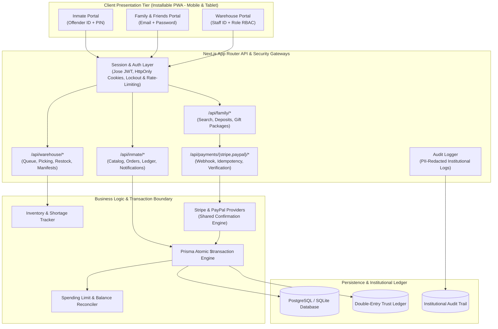

# ARCHITECTURE.md: CANTEEN CORNER System Architecture & Compliance

## 1. Overview & System Purpose
**CANTEEN CORNER** is an institutional digital commissary and inmate trust accounting platform engineered for correctional institutions. It isolates three distinct stakeholder domains into secure, dedicated portals while reconciling financial and inventory state through an auditable, double-entry ledger.

---

## 2. Three Role-Based Portals

| Portal | Target Audience | Authentication Mechanism | Primary Responsibilities |
| :--- | :--- | :--- | :--- |
| **Inmate Portal** | Incarcerated individuals (Tablets / Shared Kiosks) | Offender ID (`A1234567`) + numeric PIN (`1234`) | Commissary catalog shopping, live trust balance & weekly limit checks, atomic order submission, order history, notification inbox. 30-min auto-logout kiosk timer. |
| **Family & Friends Portal** | Approved family & verified sponsors | Email + Password (Bcrypt) + Account Verification | Offender search, instant commissary fund deposits powered by Stripe & PayPal, care gift packages subject to facility approval, audit receipts. |
| **Warehouse Portal** | Institutional fulfillment staff (Pickers & Supervisors) | Staff ID (`STF-01` / `STF-02`) or Email + Password | Incoming fulfillment queue, split-screen picking sheet, barcode/camera order packaging, inventory shortage tracking, delivery manifest generation (PDF/CSV). |

---

## 3. High-Level Architecture Diagram

---

## 4. Financial Compliance & Double-Entry Ledger
To eliminate trust fund balance discrepancies and ensure full audit compliance:
1. Inmate balance is **never** updated in isolation.
2. Every balance change triggers an immutable row in the `LedgerEntry` table with:
   - `type`: `DEPOSIT`, `COMMISSARY_ORDER`, `REFUND`, `ADJUSTMENT`
   - `debit`: exact deducted funds
   - `credit`: exact deposited funds
   - `balanceBefore`: verified snapshot prior to transaction
   - `balanceAfter`: verified post-transaction state
   - `referenceType` & `referenceId`: links directly to `#CC-xxxxx` order or deposit reference
3. Invariant formula enforced by database transaction:
   $$\text{balanceAfter} = \text{balanceBefore} + \text{credit} - \text{debit}$$

---

## 5. Stripe & PayPal Payments Architecture
Supported payment methods include Credit/Debit Cards (Stripe) and PayPal institutional deposits:
- `IPaymentProvider` interface defines contract: `createPaymentIntent`, `verifyWebhook`, `processPaymentConfirmation`, `getPaymentStatus`.
- Implementations:
  - `StripeProvider`: Stripe Checkout Sessions, PaymentIntents, and HMAC SHA256 `stripe-signature` verification.
  - `PayPalProvider`: PayPal v2 Orders API, payment capture, and cryptographic transmission webhook verification.
- **Shared Confirmation Engine** (`confirmation.ts`):
  - Validates amount, currency ('USD'), idempotency key, and facility deposit limit.
  - Inmate accounts are credited **strictly** upon verified webhook confirmation through Supabase atomic RPC in production or Prisma interactive transaction in local dev.
  - Idempotency key tracking (`Deposit.idempotencyKey`) ensures repeat webhook deliveries never double-credit inmate accounts.

---

## 6. Warehouse Fulfillment & Manifests
- **Picking List**: Formatted with high-contrast print CSS and barcode `#BC-CC-xxxxx`.
- **Packaging Workflow**: Camera scanner (via HTML5 getUserMedia) with manual keypad fallback.
- **Shortage Tracker**: Automatically flags products where $\text{stock} \le \text{reorderLevel}$ and lists pending unfulfilled orders waiting for stock.
- **Manifest Engine**: Consolidates orders by housing unit and scheduled distribution date, exporting to standardized CSV and printable PDF receipt sheets.

---

## 7. Security & Compliance Safeguards
- **PIN/Password Hashing**: `bcryptjs` with 10 salt rounds.
- **Lockout & Rate Limiting**: 5 failed PIN/password attempts triggers automatic 15-minute lockout.
- **Session Timers**: Inmates on kiosks are subject to auto-expiring 30-minute JWT sessions with countdown display.
- **PII Scrubbing**: Audit log systematically sanitizes card details, PINs, and passwords.

