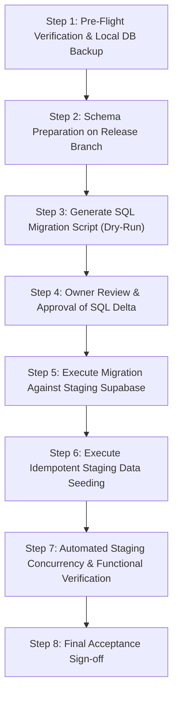

# Canteen Corner — Prisma PostgreSQL Migration Runbook
**Phase:** 8A — PostgreSQL Compatibility Preparation  
**Target:** Separate Supabase PostgreSQL Staging Project  
**Prisma Engine:** Prisma 5.22.0  
**Status:** DRAFT RUNBOOK (No remote execution authorized during Phase 8A)  

---

## 1. Safety Directives & Scope Boundaries

> [!CAUTION]
> This runbook is a documented operational procedure for future execution during Phase 8B.
> DO NOT execute any command in this runbook during Phase 8A.
> All execution requires explicit authorization from the project owner.

### Core Safety Invariants:
1. **Zero Remote Connections in 8A:** Phase 8A is strictly local.
2. **Local SQLite Preservation:** `prisma/dev.db` and the local test suite must remain operational at all times.
3. **Staging Project Exclusivity:** Migrations are applied exclusively to a dedicated staging Supabase project, never production.

---

## 2. Step-by-Step Staging Migration Procedure (Phase 8B)



### Step 1: Pre-Flight Verification & Local DB Backup
Before altering any configuration or branch:
1. Confirm local git status: `git status --short`.
2. Take a local compressed backup of `prisma/dev.db`:
   ```powershell
   Copy-Item "prisma/dev.db" "prisma/dev.db.bak.$(Get-Date -Format 'yyyyMMddHHmmss')"
   ```
3. Run the baseline regression test suite (`npm test`) and confirm 115 tests pass.

### Step 2: Schema Preparation on Release Branch
1. Create a dedicated release branch:
   ```bash
   git checkout -b release/phase8-postgresql-staging
   ```
2. Configure `prisma/schema.prisma` for PostgreSQL:
   ```prisma
   datasource db {
     provider  = "postgresql"
     url       = env("DATABASE_URL")
     directUrl = env("DIRECT_URL")
   }
   ```
3. Update financial model fields from `Float` to `@db.Decimal(10, 2)`.
4. Apply table mappings (`@@map`) to align Prisma with Supabase conventions if applicable.

### Step 3: Migration Generation (Offline Dry-Run)
Generate the native SQL migration without executing against the database:
```bash
npx prisma migrate diff \
  --from-empty \
  --to-schema-datamodel prisma/schema.prisma \
  --script > prisma/migrations/20261117_init_postgresql.sql
```

### Step 4: Owner Review & Approval
Inspect the generated `20261117_init_postgresql.sql` file:
- Confirm that all monetary fields use `NUMERIC(10, 2)`.
- Confirm foreign key constraints enforce `ON DELETE RESTRICT` on facilities and offenders, and `ON DELETE CASCADE` on order items.
- Confirm composite unique constraints (`familyAccountId, offenderId`) are present.
- Submit the SQL diff to the project owner for explicit authorization.

### Step 5: Staging Migration Execution
Once approved, execute against the staging database using direct connection:
```bash
npx prisma migrate deploy
```
*(Uses `DIRECT_URL` on port 5432 to bypass PgBouncer transaction pooling limitations during schema DDL).*

### Step 6: Idempotent Staging Data Seeding
Run the staging seed script to initialize synthetic records:
- Facility: Cumberland Regional Correctional Center (`FACILITY_CC_01`).
- Offender: John Smith (`A1234567`), initial balance $82.50.
- Products: 9 catalog commissary products.
- Demo Accounts: Family member, Warehouse Picker, Warehouse Supervisor, Administrator.

### Step 7: Automated Verification
Run the verification test suite configured against staging environment:
1. Multi-role authentication (PIN pad, password).
2. Facility boundary isolation (Cross-facility IDOR rejection).
3. Concurrency test: 10 parallel order submissions attempting balance overdraft.
4. Electronic payment webhook processing.

---

## 3. Rollback & Disaster Recovery Runbook

If a migration fails or encounters unexpected errors in staging:

### Immediate Rollback Steps:
1. **Cease Migration Execution:** Kill the migration process immediately.
2. **Inspect Migration Log Table:**
   Query `_prisma_migrations` in PostgreSQL:
   ```sql
   SELECT id, checksum, finished_at, migration_name, logs, rolled_back_at 
   FROM _prisma_migrations 
   ORDER BY started_at DESC LIMIT 5;
   ```
3. **Mark Failed Migration as Rolled Back:**
   ```bash
   npx prisma migrate resolve --rolled-back "20261117_init_postgresql"
   ```
4. **Preserve Error Artifacts:** Save complete terminal logs to `docs/deployment/phase-8a/migration-failure-log.txt`.
5. **Revert Branch:** Switch back to `main` branch to resume local SQLite development without any disruption.

